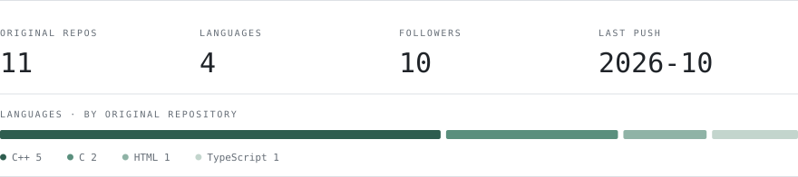

<picture>
  <source media="(prefers-color-scheme: dark)" srcset="assets/header-dark.svg">
  
</picture>

I build small systems, and then the instrument that decides whether they actually work.

### Now

**hoagent** — a lightweight ReAct coding agent in Python. Multi-provider, 19 tools, built to be measured rather than demoed.

**LLM for IR** — my research direction: generative retrieval. The model emits a document's identifier directly, instead of scoring a fixed candidate set. Right now that means reproducing OneRec, which applies the same idea to recommendation.

<picture>
  <source media="(prefers-color-scheme: dark)" srcset="assets/result-dark.svg">
  
</picture>

### Before that

**[chat](https://github.com/howardatri/chat)** — C++ service work: gRPC + protobuf, Redis, MySQL.

### Activity

<picture>
  <source media="(prefers-color-scheme: dark)" srcset="assets/stats-dark.svg">
  
</picture>

### Elsewhere

[Blog](https://howardatri.github.io) &nbsp;·&nbsp; [Howard22022@outlook.com](mailto:Howard22022@outlook.com)

写系统，也写能证伪它的仪器。上面那个 −39.4% 不花一分钱 API 费就能复现。
