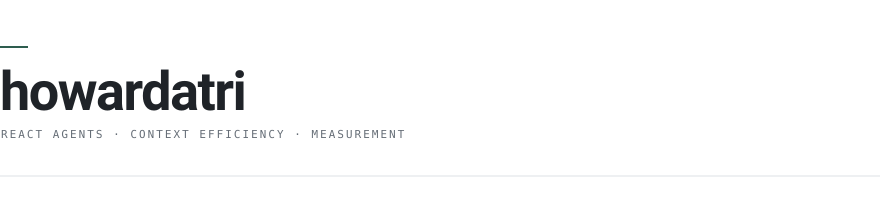
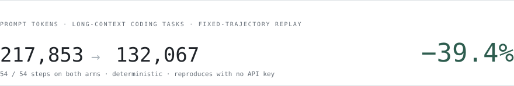

<picture>
  <source media="(prefers-color-scheme: dark)" srcset="assets/header-dark.svg">
  
</picture>

I build small systems, and then the instrument that decides whether they actually work.

### Now

**[hoagent](https://github.com/howardatri/hoagent)** — a lightweight ReAct coding agent in Python. Multi-provider, 19 tools, built to be measured rather than demoed.

The agent was the easy part. The harness around it is where the work is.

<picture>
  <source media="(prefers-color-scheme: dark)" srcset="assets/result-dark.svg">
  
</picture>

### What it took to believe that number

- **Measure the ruler before the effect.** Same configuration twice, byte-identical output. If the effect is smaller than the noise floor, the answer is *not measurable* — not a number with a decimal point.
- **Fix the trajectory.** Replay a recorded tool-call sequence so both arms run the same 54 steps. The only variable left is one boolean.
- **Spend nothing.** Every figure above reproduces from a clone. No key, no budget, no GPU.

### What isn't in the results

Three mechanisms went in. One produced a number I could defend. The circuit breaker read **+2.2%** and the skill library **−3.5%** on the same instrument — under the noise, or unmeasurable by construction. They're written up as negatives instead of deleted.

I also retracted a number I had already published. A cross-run comparison said the breaker saved 38.2% of steps; a single-variable control reversed it twice. It's still in the repo, marked dead.

### Before that

**[chat](https://github.com/howardatri/chat)** — C++ service work: gRPC + protobuf, Redis, MySQL.

### Elsewhere

[hoagent](https://github.com/howardatri/hoagent) &nbsp;·&nbsp; [RESULTS.md](https://github.com/howardatri/hoagent/blob/phase7/RESULTS.md) &nbsp;·&nbsp; [Howard22022@outlook.com](mailto:Howard22022@outlook.com)

写系统，也写能证伪它的仪器。上面那个 −39.4% 不花一分钱 API 费就能复现。
